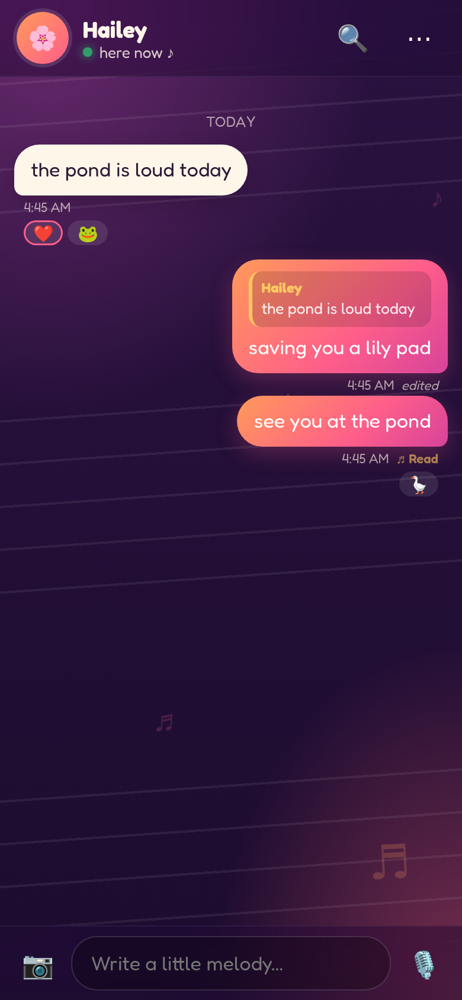
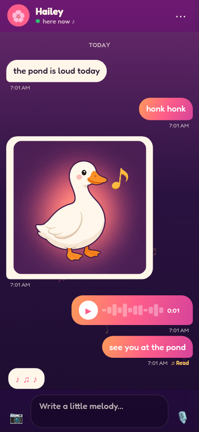

# Flarmalodebop ♫

A private messenger for exactly two people. Warm musical theme, live text, photos, voice notes, reactions, replies, edits, search, and read receipts. It runs as a web app you can install on an iPhone home screen, and as an Expo app you can open in Expo Go today and ship to TestFlight when an Apple Developer account is ready.

The sample shots below are fixture threads used to build the UI, not a real conversation.





Replace those with your own App Store screenshots before you submit. A 6.7-inch and a 6.1-inch iPhone capture of the signed-in thread, plus the sign-in screen, are what App Store Connect asks for.

## What you need

- Node.js 22 or newer
- A [Supabase](https://supabase.com) project of your own
- For a store build later: an [Apple Developer](https://developer.apple.com) account and an Expo account. Expo Go does not need either.

## Point it at your Supabase project

1. In the Supabase SQL editor, run [`v2/supabase/setup.sql`](v2/supabase/setup.sql). It creates the tables, forces Row Level Security, and limits the thread to invited members.
2. If the project already ran an older copy of that file, also run [`v2/supabase/migrations/20261115060000_private_helpers_and_force_rls.sql`](v2/supabase/migrations/20261115060000_private_helpers_and_force_rls.sql), then [`v2/supabase/migrations/20261127120000_shared_calendar_restaurant_meetups.sql`](v2/supabase/migrations/20261127120000_shared_calendar_restaurant_meetups.sql). That migration adds the shared calendar and daily restaurant meetups. It does not rewrite messages or accounts.
3. Create the two users out of band (the dashboard, or a SQL file you do **not** commit). Their emails must match `allowed_members` in `setup.sql`. Change those emails in the SQL and in both clients before you invite anyone else.
4. Authentication → turn **Allow new users to sign up** off.
5. Copy [`v2/public/config.example.js`](v2/public/config.example.js) over `v2/public/config.js` and set your project URL and publishable key. Put the same two values in [`ios-app/src/lib/config.ts`](ios-app/src/lib/config.ts).

The publishable key is designed to live in the app. The service-role key, database password, member passwords, and the VAPID private key are not. See [SECURITY.md](SECURITY.md) and [`.env.example`](.env.example).

Privacy policy for the web app and for App Store Connect: `/privacy.html` on the deployed site (source: [`v2/public/privacy.html`](v2/public/privacy.html)).

## Run the web app

The current app is the static site in `v2/`. From the repo root:

```bash
cd v2/public
python3 -m http.server 8793 --bind 127.0.0.1
```

Open http://127.0.0.1:8793 . To install it on an iPhone, serve that folder over HTTPS (Vercel is the path in [`v2/DEPLOY_STEPS.md`](v2/DEPLOY_STEPS.md)), then in Safari use Share → Add to Home Screen. The manifest, 192 and 512 icons, maskable icon, and service worker are what make it installable. Push notifications on iOS need 16.4 or newer and the home-screen icon, plus the optional `push` edge function.

There is also an older Node server in the repo root (`server.js`, SQLite, no Supabase). `npm install` then `node setup.js` and `./run.sh`. New installs should use `v2/`.

## Run the iOS app in Expo Go

No Apple account required.

```bash
cd ios-app
npm install
npx expo start
```

Scan the QR code with the iPhone camera and open the project in Expo Go. `npx expo start --ios` needs a Mac. `npm run web` runs the same UI in a browser.

```bash
npm test
npm run typecheck
```

## TestFlight and the App Store

Bundle id `app.flarmalodebop.ios`. Icons and the splash screen are already in `ios-app/assets`. [`ios-app/eas.json`](ios-app/eas.json) has `development` (simulator), `preview` (internal device), and `production` (App Store / TestFlight) profiles. Step-by-step, including the privacy policy URL, is in [`ios-app/TESTFLIGHT.md`](ios-app/TESTFLIGHT.md).

```bash
cd ios-app
npx eas-cli@latest build -p ios --profile production
npx eas-cli@latest submit -p ios --profile production --latest
```

`eas init` writes `extra.eas.projectId` into `app.json`. That id is not a secret. Do not put the Apple password or the Supabase service-role key in the app.

## Tests

```bash
npm test                 # web chat rules
cd ios-app && npm test   # the same rules on the native side
```

## License

[MIT](LICENSE) © 2026 Matthew Finley
